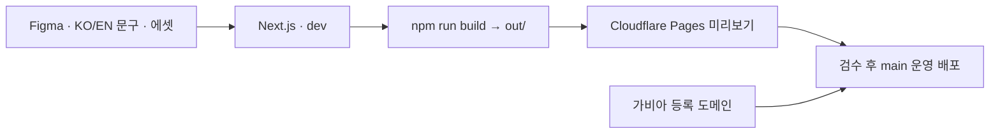

# 튜링바이오 v1.0 개발 가이드

2026-11-23 기준. `dev`에서 Next.js 앱을 초기화하는 작업부터 시작한다. 이 저장소에는 현재 README와 KO/EN 문구 데이터가 추적되고 있다. 로컬 `assets/`의 원본 이미지는 Git 미추적 상태이므로 앱에서 사용할 파일은 최적화한 뒤 소스와 함께 추적한다.

## 1. 구현 기준

[Figma v1.0](https://www.figma.com/design/pJNva0ms75DrjHCgHWKYFZ/Untitled?node-id=245-575)의 네 화면이 디자인 기준이다. 국문 데스크톱 `245:576`, 영문 데스크톱 `299:756`, 국문 모바일 `304:887`, 영문 모바일 `310:986`을 비교한다. 모바일 메뉴는 Components 섹션의 실제 열린 상태 [KO](https://www.figma.com/design/pJNva0ms75DrjHCgHWKYFZ/Untitled?node-id=329-1099)와 [EN](https://www.figma.com/design/pJNva0ms75DrjHCgHWKYFZ/Untitled?node-id=329-1130)을 사용한다.

섹션 순서는 Hero → 신뢰 지표 → CRM → RAG → 데이터 보호 원칙 → 회사 소개 → 의료 AI 이력 → 연혁 → 일하는 방식 → K-beauty 프로젝트 → 확장 역량 → 푸터다. CRM·RAG 도식은 사업을 설명하는 시각 자료로 구현한다. 사이트 범위는 회사 소개와 일반 푸터까지다.

`i18n-ko-en.json`의 각 행을 읽어 섹션별로 안정적인 키를 부여하고 국문·영문이 같은 구조를 쓰도록 한다. 같은 언어의 본문은 기기별로 바꾸지 않는다. 데스크톱 줄바꿈은 시각적 기준으로 삼고 좁은 화면에서는 CSS로 자연스럽게 처리한다. 고객사 실명·로고와 계약 협의 중인 업무 범위는 공개할 수 있는 표현으로 확인한 뒤 운영에 반영한다. 완료 화면이나 성과 수치는 추가하지 않는다.

## 2. 앱 초기화와 배포 구조

Next.js App Router, TypeScript, npm, ESLint를 사용한다. 초기화 시 Next.js와 Pages 빌드에서 함께 지원하는 Node.js 버전을 확인해 고정하고 `package-lock.json`을 커밋한다. 현재 루트에 있는 README, JSON, 이미지 원본을 보존하면서 초기화한다.

```text
src/app/[locale]/      언어별 레이아웃, 페이지, 메타데이터
src/components/       헤더·푸터와 섹션별 컴포넌트 및 CSS Modules
src/content/          타입이 같은 KO/EN 문구
src/styles/           tokens.css, globals.css
public/images/        배포용 이미지
public/_redirects     Pages 경로 이동 규칙
```



`next.config.ts`에서 `output: 'export'`와 `trailingSlash: true`를 설정한다. `generateStaticParams`로 `ko`, `en`을 생성하고 미지원 언어는 404로 처리한다. Pages에서 `/`를 `/ko/`로 연결한다. KO/EN은 실제 링크로 제공하고 동일한 섹션 ID를 사용해 현재 앵커를 유지한다. 언어별 `lang`, 제목, 설명, canonical, hreflang, OG 및 사이트맵을 제공한다. 정적 파일을 서빙하는 환경이므로 기본 서버 이미지 최적화 대신 압축한 이미지와 `picture/srcset`을 사용한다.

초기화 후 `npm ci`, `npm run dev`, `npm run lint`, `npm run typecheck`, `npm run build`가 동작하도록 스크립트를 구성한다. 타입 검사에는 `tsc --noEmit`을 사용한다.

## 3. 스타일과 에셋

**CSS Modules + CSS 변수**를 사용한다. 섹션마다 다른 그리드, 그래디언트, 글래스 효과는 해당 컴포넌트 옆의 CSS에서 관리한다. 로고, 키 컬러, 중립색, 폰트, 간격, 그림자, 헤더 높이는 Figma에서 읽어 공통 토큰으로 관리한다. 1440px와 390px를 기준으로 맞춘 뒤 360px, 768px, 1024px 중간 화면과 영문 줄바꿈을 확인한다.

Figma Assets 섹션과 로컬 원본에서 실제 시안에 쓰인 이미지를 매핑한다. `turing-ref-*`는 참조 이미지로 다루고 배포 대상은 시안에 쓰인 에셋으로 고른다. 공식 로고는 원본 비율로 사용한다. 큰 PNG는 화면에 필요한 크기의 WebP/AVIF로 준비하고 하단 이미지는 지연 로딩한다. 도식 문구는 HTML로 읽을 수 있게 유지한다.

## 4. 헤더와 모션

| 대상 | 구현 기준 |
| --- | --- |
| 헤더 | 반투명 흰색, 약한 그림자, 하단 테두리 없이 상단 고정. 데스크톱 76px, 모바일 60px |
| GNB | 사업 영역 `#crm`, 회사 소개 `#company`, 프로젝트 `#project`, 확장 역량 `#capabilities`로 직접 이동 |
| 모바일 메뉴 | 헤더는 한 개이며 햄버거가 같은 위치의 X로 전환. 현재 열린 시안의 첫 항목 여백을 적용. 본문 제목이나 별도 X 없이 전체 화면을 사용 |
| Hero·CRM·RAG | Hero 장식의 느린 움직임, CRM 연결선 흐름, RAG 단계별 강조. 모션 중에도 본문을 읽을 수 있게 유지 |
| 회사 소개 | 라벨 호버에 은은한 그림자와 오른쪽 이미지·그래디언트 변화. 클릭 이동 없음 |
| 확장 역량 | 01–03의 번호·제목·설명을 세로 중앙에 정렬하고 호버별로 작은 이미지 표시. 터치 화면은 기본 상태에서도 내용을 모두 읽을 수 있게 구성 |

앵커는 `scroll-margin-top: var(--header-height)`로 실제 헤더 높이를 반영한다. 모바일 메뉴 항목을 누르면 닫고 해당 섹션으로 이동한다. X와 Escape로도 닫을 수 있게 하고, 닫기 후 포커스는 메뉴 개폐 버튼으로 돌아간다. 클릭 이동 시에는 대상 제목에 포커스를 둔다. 헤더를 스크롤 방향에 따라 숨기는 동작은 후속 조정 사항이다. 적용할 경우 앵커 이동 중에는 헤더를 표시하고 같은 오프셋을 유지한다.

CSS 전환과 키프레임을 먼저 쓰고, 섹션 진입 감지는 IntersectionObserver로 처리한다. 메뉴처럼 상태가 필요한 작은 컴포넌트만 클라이언트에서 실행한다. `prefers-reduced-motion`에서는 반복 모션과 부드러운 스크롤을 줄이고 내용을 정적으로 표시한다.

## 5. 구현 순서와 출시 기준

1. `dev`에서 앱·다국어 경로·빌드 스크립트를 세팅하고 `out/ko/index.html`, `out/en/index.html`을 확인한다.
2. 헤더, Hero, CRM으로 디자인 토큰과 레이아웃 기준을 잡고 나머지 섹션을 확장한다. 1일차에는 두 언어의 정적 화면과 모바일 배치를 맞춘다.
3. 2일차에는 메뉴·스크롤·호버를 연결하고 내보낸 `out/`을 로컬과 Pages 미리보기에서 확인한다. Figma 설정 확인과 웹 브라우저 동작 검수는 별개다.
4. 린트·타입 검사·정적 빌드를 통과시키고, 브라우저에서 KO/EN 직접 접속과 새로고침, 언어 전환, 네 앵커의 헤더 겹침, 메뉴 개폐·이동, 호버 전환·복귀, 모바일 가로 넘침과 모션 줄이기를 검수한다.
5. Pages Free는 빌드 명령 `npm run build`, 출력 폴더 `out`, 운영 브랜치 `main`을 사용하고 `dev`에서 미리보기를 검수한다. 운영 전환 전에 기존 WordPress와 DNS 레코드를 백업한다. 가비아 도메인 등록은 유지하고 실제 DNS 관리 위치에서 웹 연결을 전환한다. 전환 후 루트·www의 HTTPS와 이동 규칙, 메일 레코드를 확인한다.

[Next.js 정적 출력](https://nextjs.org/docs/app/guides/static-exports) · [Cloudflare Pages 정적 Next.js 배포](https://developers.cloudflare.com/pages/framework-guides/nextjs/deploy-a-static-nextjs-site/)

## 6. 단계별 커밋 메시지 초안

5절의 순서와 아래 번호가 대응한다. 각 코드 블록은 제목, 본문, Git 트레일러를 포함한 메시지 초안이다. 커밋 시 `Tested:`는 실제 수행한 확인으로 바꾸고, 남은 검증은 `Not-tested:`에 남긴다.

### 1. 앱 초기화와 정적 경로

```text
Enable reproducible static builds for both site languages

Set up Next.js, TypeScript and the package lockfile so local and
preview builds produce separate Korean and English entry pages.

Constraint: Cloudflare Pages serves the static out directory
Tested: npm ci and npm run build; KO and EN index files generated
```

### 2. v1.0 화면과 반응형 스타일

```text
Make the approved company story readable across screen sizes

Build the v1.0 sections in order with shared CSS tokens, scoped
styles and bilingual copy. Optimize the assets used by each section.

Tested: KO and EN layouts compared against Figma at 390px and 1440px
```

### 3. 메뉴와 모션

```text
Keep navigation clear while bringing the technical diagrams to life

Use one mobile header for both menu states and offset section links
below the fixed header. Add diagram motion with a reduced-motion state.

Tested: Menu open and close, section jumps, hover states and reduced motion
```

### 4. 출시 전 검수와 수정

```text
Resolve issues found in the exported site before release

Record the issues reproduced on the static build and what changed
to make the language, navigation and responsive flows work.

Tested: Lint, typecheck, static build and the affected browser flows
```

수정할 코드가 없다면 검수 결과를 PR이나 실제로 갱신한 문서에 남긴다. 이 경우 커밋 제목은 `Record verification of both static site variants`를 사용한다.

### 5. 운영 배포와 도메인 전환

```text
Make the reviewed bilingual site ready for production on Pages

Record the production build settings, domain routing and rollback
steps so the cutover can be verified and repeated.

Constraint: Domain registration stays with Gabia
Tested: Preview routes, production HTTPS and root/www routing
```

DNS 전환 확인은 실제 전환 후에만 `Tested:`에 기록한다. 설정 변경이 Git 밖에서 이루어졌다면 운영 기록에 남긴다.
